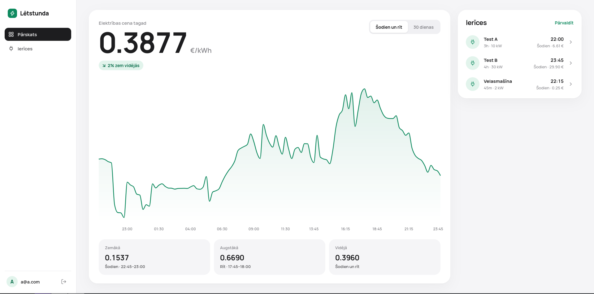
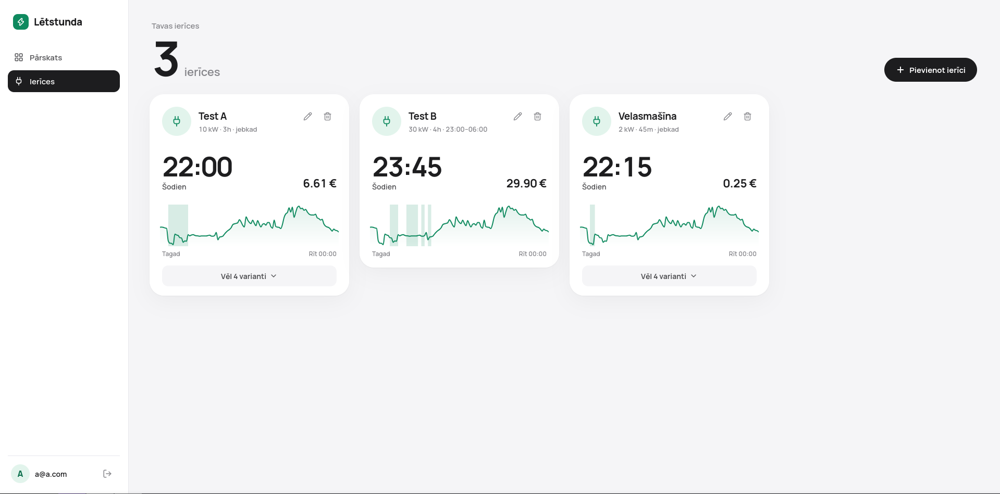
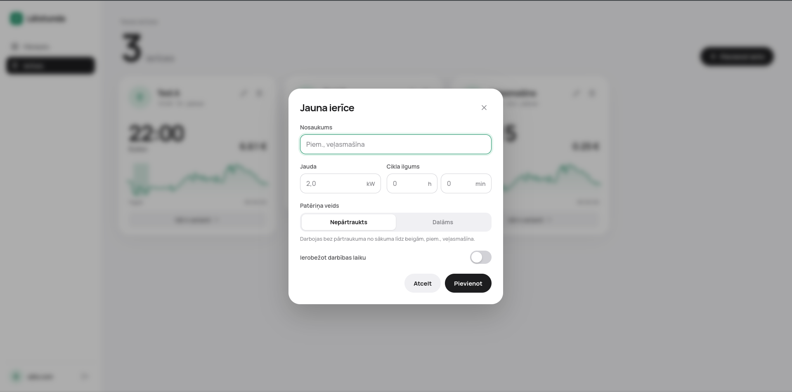

# Lētstunda

tīmekļa lietotne, kas balstoties uz Nord Pool elektroenerģijas biržas cenām Latvijā, aprēķina lētāko laiku mājsaimniecības ierīču izmantošanai (piemēram, veļasmašīnai vai elektroauto uzlādei).

Lietotājs pievieno savas ierīces (jauda, darbības cikla ilgums, vai cikls ir dalāms, atļautais darbības laiks), un lietotne katrai ierīcei piedāvā līdz piecām lētākajām darbības laika iespējām šodienai un rītdienai.

## Ekrānuzņēmumi

**Ienākšana un reģistrācija**


**Cenu pārskats** - pašreizējā cena, cenu grafiks un izvēlētās ierīces labākie laiki



**Ierīces**



**Ierīces pievienošana un rediģēšana**



## Funkcionalitāte

- Lietotāju reģistrācija un ienākšana ar e-pastu un paroli.
- Elektroenerģijas biržas cenas Latvijā ar 15 minūšu soli:
  - šodienas un rītdienas cenas (rītdienas cenas tiek publicētas ap 14:00);
  - pēdējo 30 dienu vidējās cenas;
  - zemākā, augstākā un vidējā cena.
- Ierīču pievienošana, rediģēšana un dzēšana.
- Katrai ierīcei līdz 5 lētākajiem darbības laikiem ar aptuvenām izmaksām.
- Izvēlētās ierīces laiku izcelšana cenu grafikā.

## Tehnoloģijas

| Daļa | Tehnoloģijas |
|---|---|
| Serveris | NestJS, TypeScript, `@nestjs/schedule` |
| Datubāze | PostgreSQL (Docker), Prisma ORM 7 |
| Autentifikācija | Better Auth |
| Klients | React, Vite |
| Cenu avots | [Elering](https://dashboard.elering.ee) API (Nord Pool dienas tirgus cenas) |

## Arhitektūra

### Serveris (`src/`)

- **`prices/`** - cenu iegūšana un glabāšana.
  - `elering.client.ts` - pieprasa cenas no Elering API.
  - `prices.sync.ts` - ik pēc 5 minūtēm (un startējot) ielādē šodienas un rītdienas cenas; neveiksmes gadījumā mēģina vēlreiz līdz 3 reizēm ar pieaugošu gaidīšanas laiku.
  - `prices.service.ts` - saglabā cenas datubāzē un atgriež tās pēc perioda.
- **`devices/`** - lietotāja ierīču CRUD.
- **`schedules/`** - labāko darbības laiku aprēķins.
  - `best-schedule.ts` - aprēķina algoritms
  - `schedules.service.ts` - saglabā aprēķinātās iespējas; jau iesākta iespēja netiek pārrēķināta līdz tās beigām.
- **`scripts/backfill-prices.ts`** - vienreizējs skripts vēsturisko cenu ielādei.

Laika joslas aprēķiniem serveris izmanto `Europe/Riga` (iestatīts `src/main.ts`).

## Plānošanas algoritms

1. Tiek ņemti tikai nākotnes 15 minūšu intervāli, kuru cenas jau ir zināmas (līdz rītdienas beigām).
2. Ja ierīcei ir atļautais darbības laiks (piem., 22:00–07:00), tiek izmantoti tikai intervāli šajā logā; cikls nedrīkst pārsniegt viena loga robežas.
3. Nedalāmam ciklam tiek meklēti lētākie nepārtrauktie bloki, kas savstarpēji nepārklājas.
4. Dalāmam ciklam katrā dienā vai atļautajā logā tiek izvēlēti lētākie atsevišķie intervāli.
5. Izmaksas = vidējā intervālu cena * jauda * cikla ilgums.
6. Iespējas tiek salīdzinātas ar pēdējo 30 dienu cenām: ja vidējā cena ir zemāka par 30 dienu mediānu, iespēja tiek atzīmēta kā "lēta".

## API

| Metode | Ceļš | Apraksts |
|---|---|---|
| `GET` | `/api/prices?range=upcoming\|month` | Cenas (EUR/kWh) šodienai un rītdienai vai pēdējām 30 dienām |
| `GET` | `/api/devices` | Lietotāja ierīces |
| `POST` | `/api/devices` | Pievienot ierīci |
| `PATCH` | `/api/devices/:id` | Labot ierīci |
| `DELETE` | `/api/devices/:id` | Dzēst ierīci |
| `GET` | `/api/schedules` | Labākie darbības laiki katrai lietotāja ierīcei |
| `*` | `/api/auth/*` | Better Auth (reģistrācija, ienākšana, iziešana) |

Visi `/api/devices` un `/api/schedules` pieprasījumi prasa ienākušu lietotāju.

## Palaišana izstrādes režīmā

Nepieciešams Node.js un Docker.

```bash
# 1. Vides mainīgie
cp .env.example .env
npx auth secret   # iegūto atslēgu ielīmē .env failā kā BETTER_AUTH_SECRET

# 2. Dependencies
npm install
cd frontend && npm install && cd ..

# 3. Datubāze
docker compose up -d
npx prisma migrate dev --config prisma7.config.ts
npx prisma generate --config prisma7.config.ts

# 4. (Pēc izvēles) pēdējo 31 dienas cenu ielāde 30 dienu skatam
npm run prices:backfill

# 5. Serveris (http://localhost:3000)
npm run start:dev

# 6. Klients (http://localhost:5173)
cd frontend && npm run dev
```
